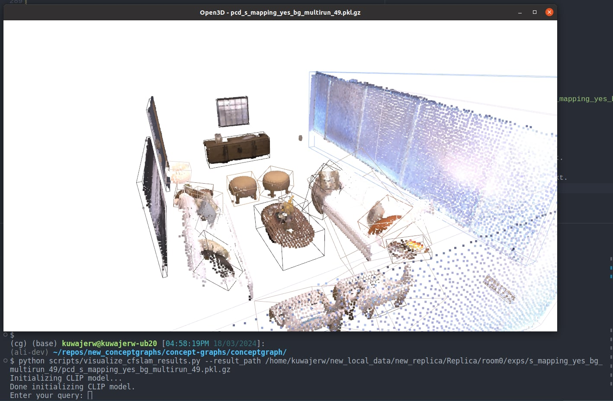
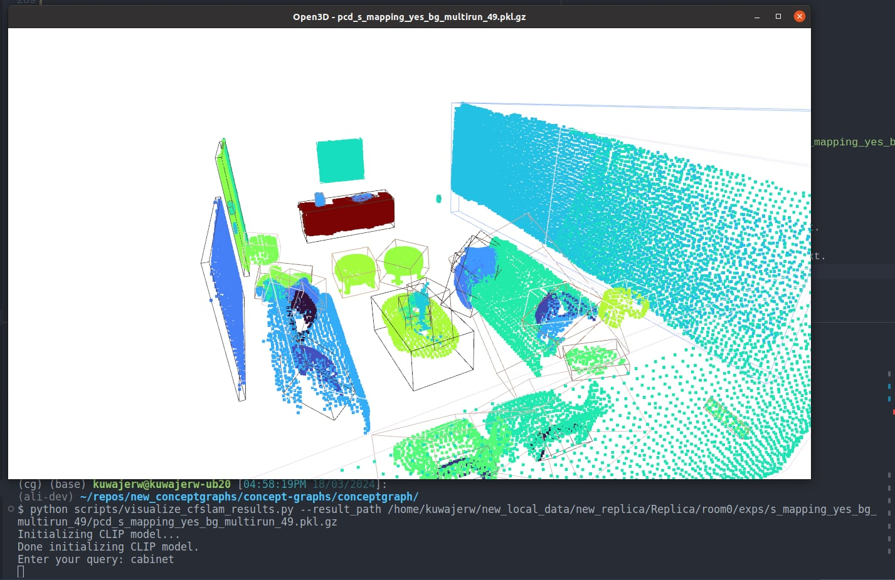

# ConceptGraphs: Open-Vocabulary 3D Scene Graphs for Perception and Planning

This repository contains the code for the ConceptGraphs project. ConceptGraphs builds open-vocabulary 3D scenegraphs that enable a broad range of perception and task planning capabilities.

[**Project Page**](https://concept-graphs.github.io/) |
[**Paper**](https://concept-graphs.github.io/assets/pdf/2023-ConceptGraphs.pdf) |
[**ArXiv**](https://arxiv.org/abs/2309.16650) |
[**Video**](https://www.youtube.com/watch?v=mRhNkQwRYnc&feature=youtu.be&ab_channel=AliK)


[Qiao Gu](https://georgegu1997.github.io/)\*,
[Ali Kuwajerwala](https://www.alihkw.com/)\*,
[Sacha Morin](https://sachamorin.github.io/)\*,
[Krishna Murthy Jatavallabhula](https://krrish94.github.io/)\*,
[Bipasha Sen](https://bipashasen.github.io/),
[Aditya Agarwal](https://skymanaditya1.github.io/),
[Corban Rivera](https://www.jhuapl.edu/work/our-organization/research-and-exploratory-development/red-staff-directory/corban-rivera),
[William Paul](https://scholar.google.com/citations?user=92bmh84AAAAJ),
[Kirsty Ellis](https://mila.quebec/en/person/kirsty-ellis/),
[Rama Chellappa](https://engineering.jhu.edu/faculty/rama-chellappa/),
[Chuang Gan](https://people.csail.mit.edu/ganchuang/),
[Celso Miguel de Melo](https://celsodemelo.net/),
[Joshua B. Tenenbaum](http://web.mit.edu/cocosci/josh.html),
[Antonio Torralba](https://groups.csail.mit.edu/vision/torralbalab/),
[Florian Shkurti](http://www.cs.toronto.edu//~florian/),
[Liam Paull](http://liampaull.ca/)


# Updates

* The `dev` branch provides the real-time, streamlined implementation, including RGB-D video support and Rerun visualization. See the [getting started tutorial](https://youtu.be/56jEFyrqqpo?si=jo-qto5Gv8qxqEw2).
* The code for real-world mapping and navigation using a Jackal robot is available [here](https://github.com/sachaMorin/concept_graphs_jackal).
* The code for localization and mapping in AI2Thor is included in this repository. See the [AI2Thor instructions](#ai2thor-related-experiments).

## Getting Started Video Tutorial 

This 1.5 hours long Youtube video is detailed getting started tutorial covering the README below as of May 7, 2024. In it, I start with a blank ubuntu 20.04, and setup ConceptGraphs, and make a map using the replica dataset and an iPhone scan. Also covers the direct streaming option! I decided to be extra detailed just in case, so feel free to skip over / through the parts that are too slow for you.

[](https://www.youtube.com/watch?v=56jEFyrqqpo)

<details >
<summary>Video Chapters (Dropdown) </summary>
<br>
  
0:00 Welcome Introduction

1:09 Tutorial Starts

1:58 Download Dataset

3:17 Conda Env Setup Starts

9:32 Setting CUDA_HOME env variable

14:18 Install ali-dev ConceptGraphs into conda env

16:39 Build map w Replica Dataset starts

18:38 Weird Indent Error

19:27 Config Setup and Related Errors Explanation starts

21:13 Hydra Config Composition explained

25:00 Setting repo_root and data_root in base_paths YAML

27:25 Initial Overview of mapping script

29:02 Changing SAM to MobileSAM

30:27 Commenting out openai api for now

31:48 Overview of changes so far

32:09 Initial look at Rerun window

33:44 Overview of changes so far part 2

35:01 Stopping the map building early explained

35:32 Saving the Rerun data

37:52 Saving the map

38:33 last_pcd_save Symbolic Link Explained

39:42 Exploring the Finished Experiment Folder

42:40 Saved param file for the Experiment

45:00 Searching the map with natural language queries

48:42 Overview of changes so far part 3

50:10 Reusing detections

52:21 Showing off Rerun Visualization features

54:43 Incomplete Dataset Reuse Issue

55:38 Summary and Recap So far

56:19 Using an iPhone as RGB-D sensor starts

56:46 Record3D app explained

57:49 Setting up and extracting r3d file dataset

59:31 Preprocessing extracted r3d dataset 

1:01:42 Missing dependencies fix 

1:04:31 Building and saving  map with iPhone dataset

1:09:41 Searching the co_store map with natural language queries

1:10:56 Streaming data directly from iPhone explanation starts 

1:14:10 Installing record3D git repo and cmake

1:18:29 setting up OpenAI API key env variable  

1:20:03 Streaming directly from iPhone working 

1:22:21 Searching the streamed iPhone map with natural language queries

1:23:41 Edges explanation starts

1:24:58 Building a map with edges and using the VSCode Debugger starts

1:25:22 Explaining the VSCode launch.json debug config

1:27:21 Building a map with Edges

1:29:17 Summary and recap of video and changes so far

1:30:28 High level overview of main mapping script

1:35:19 How to use the VSCode debugger

1:37:12 Summary and recap of video and changes so far part 2

1:37:49 Outro and goodbye

</details>


## Installation

### Code

ConceptGraphs is built using Python. We recommend using [Anaconda](https://www.anaconda.com/download) to manage your python environment. It creates a separate environment for each project, which is useful for managing dependencies and ensuring that you don't have conflicting versions of packages from other projects.

**NOTE:** Sometimes certain versions of ubuntu/windows, python, pytorch and cuda may not work well together. Unfortunately this means you may need to do some trial and error to get everything working. We have included the versions of the packages we used on our machines, which ran Ubuntu 20.04.

To create your python environment, run the following commands:

```bash
# Create the conda environment
conda create -n conceptgraph python=3.10
conda activate conceptgraph

##### Install Pytorch according to your own setup #####
# For example, if you have a GPU with CUDA 11.8 (We tested it Pytorch 2.0.1)
conda install pytorch==2.0.1 torchvision==0.15.2 torchaudio==2.0.2 pytorch-cuda=11.8 -c pytorch -c nvidia

# Install the Faiss library (CPU version should be fine), this is used for quick indexing of pointclouds for duplicate object matching and merging
conda install -c pytorch faiss-cpu=1.7.4 mkl=2021 blas=1.0=mkl

# Install Pytorch3D (https://github.com/facebookresearch/pytorch3d/blob/main/INSTALL.md)
# conda install pytorch3d -c pytorch3d # This detects a conflict. You can use the command below, maybe with a different version
conda install https://anaconda.org/pytorch3d/pytorch3d/0.7.4/download/linux-64/pytorch3d-0.7.4-py310_cu118_pyt201.tar.bz2

# We find that cuda development toolkit is the least problemantic way to install cuda. 
# Make sure the version you install is at least close to your cuda version. 
# See here: https://anaconda.org/conda-forge/cudatoolkit-dev
conda install -c conda-forge cudatoolkit-dev

# Install the other required libraries
pip install tyro open_clip_torch wandb h5py openai hydra-core distinctipy ultralytics dill supervision open3d imageio natsort kornia rerun-sdk pyliblzfse pypng git+https://github.com/ultralytics/CLIP.git

# You also need to ensure that the installed packages can find the right cuda installation.
# You can do this by setting the CUDA_HOME environment variable.
# You can manually set it to the python environment you are using, or set it to the conda prefix of the environment.
# for me its export CUDA_HOME=/home/kuwajerw/anaconda3/envs/conceptgraph
export CUDA_HOME=/path/to/anaconda3/envs/conceptgraph

# Finally install conceptgraphs
cd /path/to/code/ # wherever you want to install conceptgraphs
# for me its /home/kuwajerw/repos/
git clone https://github.com/concept-graphs/concept-graphs.git
cd concept-graphs
git checkout ali-dev
pip install -e .
```

### Datasets

#### Replica 
Now you will need some data to run the code on, the easiest one to use is the [Replica](https://github.com/facebookresearch/Replica-Dataset). You can install it by using the following commands:

```bash
cd /path/to/data
# you can also download the Replica.zip manually through
# link: https://caiyun.139.com/m/i?1A5Ch5C3abNiL password: v3fY (the zip is split into smaller zips because of the size limitation of caiyun)
wget https://cvg-data.inf.ethz.ch/nice-slam/data/Replica.zip
unzip Replica.zip
```

#### iPhone scan via Record 3D app (r3d file) of a convenience store aisle
I've also uploaded a scan I took of a convenience store with a lot of objects, you can download that from Kaggle via [this link](https://www.kaggle.com/datasets/alihkw/convinience-store-recording-via-the-record3d-app/). This is a record3d file `.r3d` that we will need to preprocess before we can use it as a dataset. More on that below.

And now you will need to update the paths in the configuration files in the `conceptgraph/hydra_configs` directory to point to your paths. Which is discussed below:

## Usage

We have a lot of scripts with different features, but I reccomend starting with the `rerun_realtime_mapping.py` script, which runs the detections, builds the scene graph, and vizualizes the results all in one loop.

**After you have changed the needed configuration values**, you can run a script with a simple command, for example:

```bash
# set up your config first as explained below, then
cd /path/to/code/concept-graphs/conceptgraph/
python slam/rerun_realtime_mapping.py
```


### Setting up your configuration 
We use the [hydra](https://hydra.cc/) package to manage the configuration, so you don't have to give it a bunch of command line arguments, just edit the  entries in the corresponding `.yaml` file in `./conceptgraph/hydra_configs/` and run the script.

For example here is my `./conceptgraph/hydra_configs/rerun_realtime_mapping.yaml` file:

```yaml
defaults:
  - base
  - base_mapping
  - replica
  - sam
  - classes
  - logging_level
  - _self_

detections_exp_suffix: s_detections_stride_10_run2 # just a convenient name for the detection run
force_detection: !!bool False
save_detections: !!bool True

use_rerun: !!bool True
save_rerun: !!bool True

stride: 10
exp_suffix: r_mapping_stride_10_run2 # just a convenient name for the mapping run
```

First the values are loaded from `base.yaml`, then `base_mapping.yaml` then `replica.yaml` and so on. If there is a conflict (i.e. two files are modifying the same config parameter), the values from the earlier file are overwritten. i.e. `replica.yaml` will overwrite any confliting values in `base.yaml` and so on.

Finally `_self_` is loaded, which are te values in `rerun_realtime_mapping.yaml` itself. This is where you can put your own custom values. Also feel free to add your own `.yaml` files to `./conceptgraph/hydra_configs/` and they will be loaded in the same way.

#### Paths

The first thing to set in your config files is where you've installed conceptgraphs and where your data is. Update this in the `./conceptgraph/hydra_configs/base_paaths.yaml` file. For me, it is:

```yaml
repo_root: /home/kuwajerw/repos/concept-graphs
data_root: /home/kuwajerw/local_data
```

### Building the map

To build the map, simply run the following command from the `conceptgraph` directory:

```bash
cd /path/to/code/concept-graphs/conceptgraph/
python /slam/rerun_realtime_mapping.py
```

Note that if you don't have the models installed, it should just automatically download them for you.

The results are saved in the corresponding dataset directory, in a folder called `exps`. It will name the folder with the `exp_suffix` you set in the configuration file, and also save a `config_params.json` file in that folder with the configuration parameters used for the run.

**NOTE:** For convinience, the script will also automatically create a symlink `/concept-graphs/latest_pcd_save` -> `Replica/room0/exps/r_mapping_stride_10_run2/pcd_r_mapping_stride_10_run2.pkl.gz` so you can easily access the latest results by using the `latest_pcd_save` path in your argument to the visualization script.

Here is what the ouput of running the mapping script looks like for `room0` in the `Replica` dataset:

```bash
.
./Replica # This is the dataset root
./Replica/room0 # This is the scene_id
./Replica/room0/exps # This parent folder of all the results from conceptgraphs

# This is the folder for the run's detections, named according to the exp_suffix
./Replica/room0/exps/s_detections_stride_10_run2 

# This is where the visualizations are saved, they are images with bounding boxes and masks overlayed
./Replica/room0/exps/s_detections_stride_10_run2/vis 

# This is where the detection results are saved, they are in the form of pkl.gz files 
# that contain a dictionary of the detection results
./Replica/room0/exps/s_detections_stride_10_run2/detections 

# This is the mapping output folder for the specific run, named according to the exp_suffix
./Replica/room0/exps/r_mapping_stride_10_run2/
# This is the saved configuration file for the run
./Replica/room0/exps/r_mapping_stride_10_run2/config_params.json
# We also save the configuration file of the detection run which was used 
./Replica/room0/exps/r_mapping_stride_10_run2/config_params_detections.json
# The mapping results are saved in a pkl.gz file
./Replica/room0/exps/r_mapping_stride_10_run2/pcd_r_mapping_stride_10_run2.pkl.gz
# The video of the mapping process is saved in a mp4 file
./Replica/room0/exps/r_mapping_stride_10_run2/s_mapping_r_mapping_stride_10_run2.mp4
# If you set save_objects_all_frames=True, then the object mapping results are saved in a folder
./Replica/room0/exps/r_mapping_stride_10_run2//saved_obj_all_frames
# In the saved_obj_all_frames folder, there is a folder for each detection run used, and in each of those folders there is a pkl.gz file for each object mapping result
./Replica/room0/exps/r_mapping_stride_10_run2/saved_obj_all_frames/det_exp_s_detections_stride_10_run2

```

## Running the visualization script

This script allows you to vizluatize the map in 3D and query the map objects with text. The `latest_pcd_save` symlink is used to point to the latest mapping results, but you can also point it to any other mapping results you want to visualize.

```bash
cd /path/to/code/concept-graphs
python conceptgraph/scripts/visualize_cfslam_results.py \
    --result_path latest_pcd_save 
```

or if you'd like to point it to a specific result, you can just point it to the pkl.gz file directly:

```bash
cd /path/to/code/concept-graphs
python conceptgraph/scripts/visualize_cfslam_results.py \
    --result_path /path/to/data/Replica/room0/exps/r_mapping_stride_10_run2/pcd_r_mapping_stride_10_run2.pkl.gz
```

## Searching the map with text

Then in the open3d visualizer window, you can use the following key callbacks to change the visualization. 
* Press `b` to toggle the background point clouds (wall, floor, ceiling, etc.). Only works on the ConceptGraphs-Detect.
* Press `c` to color the point clouds by the object class from the tagging model. Only works on the ConceptGraphs-Detect.
* Press `r` to color the point clouds by RGB. 
* Press `f` and type text in the terminal, and the point cloud will be colored by the CLIP similarity with the input text. 
* Press `i` to color the point clouds by object instance ID. 

Here is what it looks like to search for "cabinet" in the Replica `room0` scene.

First we run the script, and then press `f` to trigger the `Enter your query:` input 



And then we can type `cabinet` and press enter, and the point cloud will be colored by the CLIP similarity with the input text.



## Using an iPhone as your RGB-D sensor

For this, you'll need to use the Record3D app and buy the premium version which costs arouund $5-10. The scans you make using the app can be exported to an `.r3d` file. You can then use googledrive or a usb cable or something else to get the `.r3d` file on to your computer. Then right click -> extract out it's contents into a folder, and you'll probably wanna rename the folder to a convenient name. 


Then you want to use the `concept-graphs/conceptgraph/dataset/preprocess_r3d_file.py` to convert that into a dataset that conceptgraphs can use. This is also covered in the getting started video. In the `preprocess_r3d_file.py`, set the datapath variable to your extracted r3d folder. So for me it is:

```
class ProgramArgs:
    # this folder contains the metadata folder and the rgb folder etc inside it
    datapath = "/home/kuwajerw/local_data/record3d_scans/co_store" 
```

Let that script run, and now you'll have a folder called `/home/kuwajerw/local_data/record3d_scans/co_store_preprocessed` which you can use with ConceptGraphs, for which you can follow the same instructions as the Replica dataset.


## Streaming the map directly from an iPhone as you're doing the scan

If you'd like to skip the dataset making process and build the map in near real time as you're recording the scan, you can use the `concept-graphs/conceptgraph/slam/r3d_stream_rerun_realtime_mapping.py` script for that, it's also covered in the getting started video. First you need to setup the record3D git repo, which requires installing cmake. After that, simply use the [USB streaming option](https://record3d.app/features) in the Record3D app, and then run the `r3d_stream_rerun_realtime_mapping.py` script to start building the map immediately. So that's:
```
sudo apt install cmake
```
and then, with your `conceptgraph` conda environment active, run these commands from the record3D github [README file](https://github.com/marek-simonik/record3d?tab=readme-ov-file#python)
```
git clone https://github.com/marek-simonik/record3d
cd record3d
python setup.py install
```
and now you can run the `r3d_stream_rerun_realtime_mapping.py` same as the previous scripts. Of course, you will have to have the iPhone streaming via USB to your computer at the same time when you run the script.
```bash
cd /path/to/code/concept-graphs/conceptgraph/
python /slam/r3d_stream_rerun_realtime_mapping.py
```

## Streaming a live Intel RealSense camera

The live mapper also accepts a RealSense RGB-D camera through `pyrealsense2`.
Install the optional adapter with `uv sync --extra realsense`, connect the camera
by USB, then start a bounded capture with:

```bash
uv run python -m conceptgraph.slam.r3d_stream_rerun_realtime_mapping \
  --config-name realsense_stream \
  force_detection=true save_detections=true device=cuda \
  dataset_root=/path/to/live_data scene_id=room_sweep \
  exp_suffix=room_sweep_mapping detections_exp_suffix=room_sweep_detections
```

`realsense_stream` defaults to 640x480 at 30 FPS and 1,800 frames. It records
aligned RGB-D frames, sensor intrinsics, depth scale, and RGB-D-odometry poses
for replay with `RealsenseDataset`. Set `realsense_serial=<serial>` to select a
specific camera. `realsense_odometry_device=CUDA:0` requires a CUDA-enabled
Open3D build; `auto` uses CUDA when available and otherwise warns before CPU
odometry. Hand-guided sweeps can accumulate odometry drift, especially when the
camera moves quickly or sees few textured surfaces. The existing live mapping
path does not generate VLM captions or relation edges during capture.

### Record, archive, then map sampled frames

Use the desktop recorder for a synchronized 1280×720 RGB-D capture at 30 FPS.
It displays the live camera stream and the observed capture rate.

```bash
uv run python -m conceptgraph.scripts.record_realsense_gui \
  --output-dir /mnt/HDD1/Project_Data/realsense_live/my_corner_office_capture
```

Start/Stop Recording finalizes one segment. Take Image stores a still with
sensor timestamps and its recording ID. Save and close finalizes the active
segment and writes `capture_session.json`.

For headless or time-limited recording, use the same archive-first path without
the button interface:

```bash
uv run python -m conceptgraph.scripts.record_realsense_bag \
  --output-dir /mnt/HDD1/Project_Data/realsense_live/my_corner_office_capture \
  --no-preview \
  --duration-seconds 60
```

The recorder temporarily writes each segment to
`.recording_tmp/recording_NNN.db3`. It exports the DB3 into
`recording_NNN_archive/`, verifies the archive against the source, then removes
the temporary DB3. It does not encode a duplicate video during capture; the
exporter creates the final review video from the archived RGB stream. The
archive contains chunked RGB/depth arrays, compressed metadata, a manifest,
and `review.mp4`. If export, verification, or capture-session metadata saving
fails, the temporary DB3 remains in `.recording_tmp/` for recovery.

Replay the archive directly. Open3D estimates motion from every timestamp-paired
RGB-D frame on CUDA; preparation samples every 15 pairs for the mapping dataset.
The archive supplies CameraInfo, sensor extrinsics, depth scale, and camera
timestamps. Depth is projected into the color camera before pose estimation.

```bash
uv run python -m conceptgraph.scripts.prepare_realsense_bag \
  --archive /mnt/HDD1/Project_Data/realsense_live/my_corner_office_capture/recording_001_archive \
  --dataset-root /mnt/HDD1/Project_Data/realsense_live/prepared \
  --scene-id my_corner_office \
  --capture-session /mnt/HDD1/Project_Data/realsense_live/my_corner_office_capture/capture_session.json \
  --sample-every 15 \
  --sample-offset 0 \
  --odometry-device CUDA:0
```

The optional capture-session file adds the nearest odometry pose to still images
within 50 ms. Omit it when no capture session exists; missing session metadata
skips still-image pose association without invalidating the prepared dataset.
Archive preparation does not need librealsense playback. It requires
CUDA-enabled Open3D by default and fails clearly if that build is unavailable.
Choose another offset from 0 through 14 and a new scene ID to create a different
temporal sample. Separate sample sets are not merged automatically.

Map the prepared dataset with the existing batch mapper. The source recording
is 16:9, so 640×360 keeps its aspect ratio while reducing mapping cost.

```bash
uv run python -m conceptgraph.slam.rerun_realtime_mapping \
  --config-name rerun_realtime_mapping \
  force_detection=true save_detections=true device=cuda \
  dataset_root=/mnt/HDD1/Project_Data/realsense_live/prepared \
  scene_id=my_corner_office \
  dataset_config=/mnt/HDD1/Project_Data/realsense_live/prepared/my_corner_office/dataconfig.yaml \
  stride=1 image_height=360 image_width=640 \
  exp_suffix=my_corner_office_mapping \
  detections_exp_suffix=my_corner_office_detections
```

Current librealsense records to `.db3`; the recorder treats it as a temporary
source and publishes only the verified archive. Native recording requires SDK
2.58.1 or newer. Install it through `uv sync --extra realsense`. Preparation
also accepts legacy `.bag` and `.db3` recordings through `--bag`. See the [official release
notes](https://github.com/realsenseai/librealsense/wiki/Release-Notes) and
[record/playback guide](https://github.com/realsenseai/librealsense/blob/master/doc/record-and-playback.md).
The recorder’s `--no-preview` option supports
headless capture, and `--duration-seconds N` stops automatically after N
seconds. See [recording_guideline.md](recording_guideline.md) for a suggested
room sweep and capture-rate interpretation.

To convert an existing `.db3` manually into chunked Python-readable streams
plus a playable HEVC review video, run:

```bash
uv run python -m conceptgraph.scripts.export_realsense_recording \
  --recording /mnt/HDD1/Project_Data/realsense_live/my_corner_office.db3 \
  --output-dir /mnt/HDD1/Project_Data/realsense_live/my_corner_office_archive
```

The export keeps the exact original compressed RGB image payloads, whether
PNG or JPEG, in packed `.npz` chunks with offsets. The container does not
recompress those already compressed payloads. Depth frames and other DB3
messages, including camera metadata, remain compressed NPZ chunks. Export
verification checks RGB bytes, decoded image pixels, depth arrays, and
metadata against the read-only source. The source recording is preserved.

Archive readers can retrieve original RGB bytes or decode frames on demand,
without touching SQLite:

```python
from conceptgraph.utils.realsense_archive import NumpyArchiveReader

reader = NumpyArchiveReader(
    "/mnt/HDD1/Project_Data/realsense_live/my_corner_office_archive"
)
for frame in reader.iter_images("rgb"):
    rgb_array = frame.frame  # decoded uint8 RGB pixels
    timestamp_ns = frame.timestamp_ns

for encoded in reader.iter_encoded_images():
    encoded_bytes = encoded.payload  # original compressed PNG/JPEG bytes
    image_format = encoded.format

for message in reader.iter_metadata(topic_name="/device_0/sensor_1/Color_0/image/metadata"):
    payload = message.payload  # exact CDR bytes, parsed only if needed
```

Chunks are loaded one at a time. The exporter has already verified their
hashes; pass `verify_hashes=True` to `NumpyArchiveReader` for another full hash
check during reading.

The archive does not store color-aligned depth or estimated camera poses.
`prepare_realsense_bag --archive` derives calibration from archived metadata,
aligns depth, estimates odometry, and writes the sampled dataset directly.

## Debugging

We've commited a pre-made vscode debug config file to the repo to make debugging simple. You can find it at `concept-graphs/.vscode/launch.json`. Here you'll find launch commands to run the core scripts talked about in this README. If you're not familiar with the vscode debugger, check out the getting started video, or the vscode [docs](https://code.visualstudio.com/docs/python/debugging).


## Misc

To stop a script early, you can use the `concept-graphs/conceptgraph/hydra_configs/early_exit.json` file. If you set `early_exit: true` in the file, then the script will exit early after the current iteration is finished. This is useful if you want to stop the script early, but still save the results from the current iteration.

# Classes File

The classes file is used as a set of class labels to the object detection model. This is a tradeoff between sacrificing some "open-vocabulary-ness" for more stable detections. We have two classes files avaiable:
```bash
concept-graphs/conceptgraph/scannet200_classes.txt
concept-graphs/conceptgraph/ram_classes_4500.txt
```
The scannet classes are the labels from the [scannet200 dataset](https://rozdavid.github.io/scannet200).
The ram classes are the tags from the [RAM model](https://recognize-anything.github.io/).


## Troubleshooting

Sometimes for X11 or Qt related errors, I had to put this in my bashrc file to fix it 
    
```bash
export XKB_CONFIG_ROOT=/usr/share/X11/xkb
```

That's all for now, we will keep updating this README with more information as we go.
